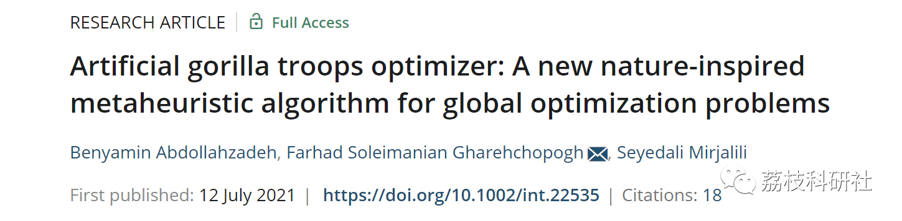
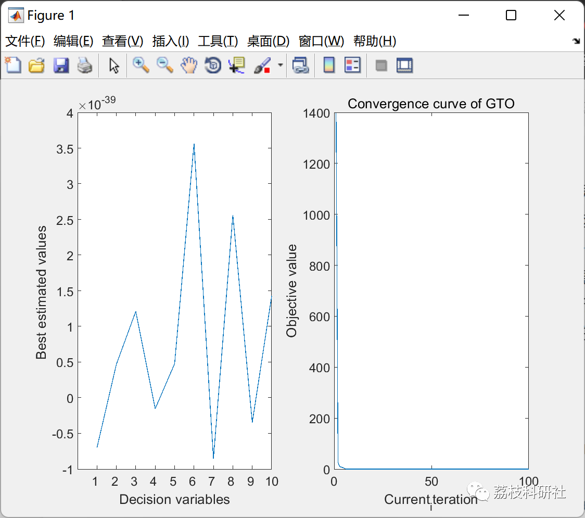

# Gorilla Optimization Algorithm (Matlab Code Implementation)

💥💥💥💞💞💞 Welcome to this blog❤️❤️❤️💥💥💥
🏆 Bloggers' Advantages: 🌞🌞🌞 The content of the blog strives for rigorous thinking and clear logic to facilitate readers.
⛳️ Mantra: A journey of a thousand miles begins with a single step.
Litchi Research Society
Code Collection: Power Systems, Intelligent Algorithms and Applications, Neural Network Prediction, Path Planning, Optimized Scheduling, Workshop Scheduling, Image Processing, Signal Processing...
🎁 Special Section Link: ​
🌈🌈🌈🌟🌟🌟 Electrical Code Intelligent Algorithms and Their Applications Path Planning Neural Network Prediction Optimized Scheduling Image Processing Workshop Scheduling Signal Processing Romantic Her
My Thoughts on Mathematical Modeling Complete Code Matters
Directory
💥1 Overview
📚2 Run Results
🎉3 References
🌈4 MATLAB Code Implementation
💥1 Overview
Metaheuristics play a key role in solving optimization problems, many of which are inspired by the collective wisdom of natural organisms in nature. This paper proposes a new metaheuristic algorithm inspired by the social intelligence of great apes in nature, called Artificial Great Ape Force Optimizer (GTO). In this algorithm, the collective life of great apes is mathematically formulated and new mechanisms are designed for exploration and exploitation. To evaluate GTO, we applied it to 52 standard benchmark functions and 7 engineering problems. Friedman test and Wilcoxon rank sum test will compare the proposed method with several existing metaheuristic methods statistically. The results show that GTO performs better than the compared algorithms on most benchmark functions, especially on high-dimensional problems. The results indicate that GTO can provide better results compared to other metaheuristic methods.
📚2 Run Results
🎉3 References
🌈4 MATLAB Code Implementation
Click the article bottom left [Read Full Article]

## Images

<!-- PAYMENT_BLOCK -->

## Get this dataset

- Payment link (Stripe): [Buy now](https://buy.stripe.com/3cs8yP7sY87d0vu9AB)
- Payment QR code: 

<!-- /PAYMENT_BLOCK -->
